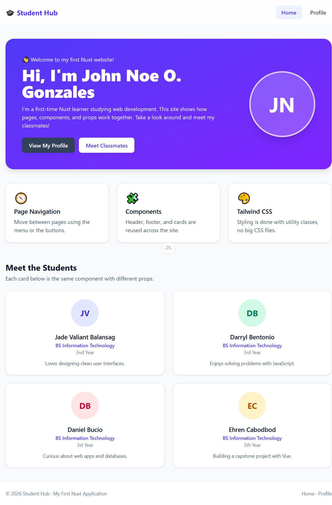
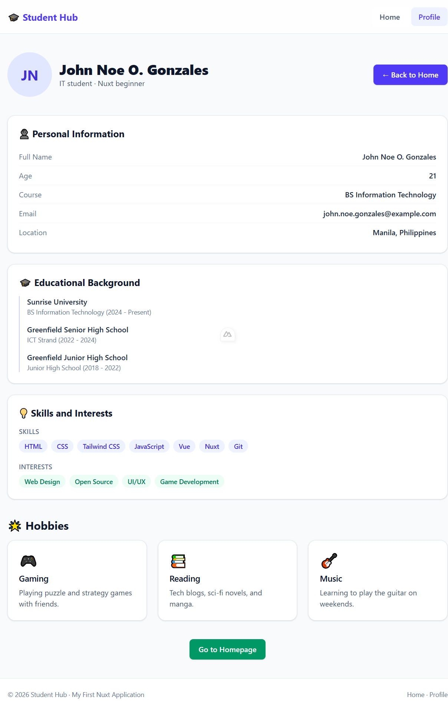
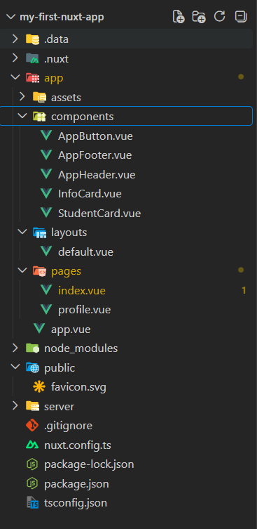

# My First Nuxt Application

A two-page personal profile website built with **Nuxt.js**, **Vue** and **Tailwind CSS**.
Made as a beginner activity to practice pages, layouts, reusable components and props.

**Author:** John (replace with your full name)
**Course / Section:** (replace with your course and section)

## Pages

| Page | Route | What it shows |
|------|-------|---------------|
| Homepage | `/` | Name, short introduction, avatar, welcome message, navigation menu, student cards |
| Profile | `/profile` | Personal information, educational background, skills and interests, hobbies |

Both pages share the same header and footer, and you can move between them using the menu, footer links and buttons.

## Screenshots

### Homepage


### Profile Page


### Project Folder Structure


## Technologies Used

- [Nuxt](https://nuxt.com/) (Vue framework)
- [Vue 3](https://vuejs.org/)
- [Tailwind CSS](https://tailwindcss.com/)

## Project Structure

```
my-first-nuxt-app/
├── app/
│   ├── app.vue                 # Root of the app
│   ├── layouts/
│   │   └── default.vue         # Header + page content + footer
│   ├── pages/
│   │   ├── index.vue           # Homepage
│   │   └── profile.vue         # Profile page
│   ├── components/
│   │   ├── AppHeader.vue       # Logo and navigation menu
│   │   ├── AppFooter.vue       # Footer
│   │   ├── StudentCard.vue     # Student info shown through props
│   │   ├── InfoCard.vue        # Title and description card
│   │   └── AppButton.vue       # Button customized with props
│   └── assets/css/main.css     # Tailwind CSS import
├── public/                     # Static files (favicon)
├── screenshots/                # Screenshots for submission
├── nuxt.config.ts
└── package.json
```

## What I Learned

- **Pages:** every file in `app/pages/` automatically becomes a route.
- **Layouts:** `layouts/default.vue` lets the header and footer be written once and used on every page.
- **Components:** reusable pieces of UI placed in `app/components/`.
- **Props:** data is passed from a page into a component (for example, student details into `StudentCard.vue`).
- **Tailwind CSS:** styling and responsive design using utility classes.

## How to Run Locally

Requires [Node.js](https://nodejs.org/) 20 or newer.

```bash
# 1. Install dependencies
npm install

# 2. Start the development server
npm run dev
```

Then open the address shown in the terminal, usually **http://localhost:3000**.
If port 3000 is already in use, Nuxt picks the next one (for example, 3001).

To create a production build:

```bash
npm run build
npm run preview
```
